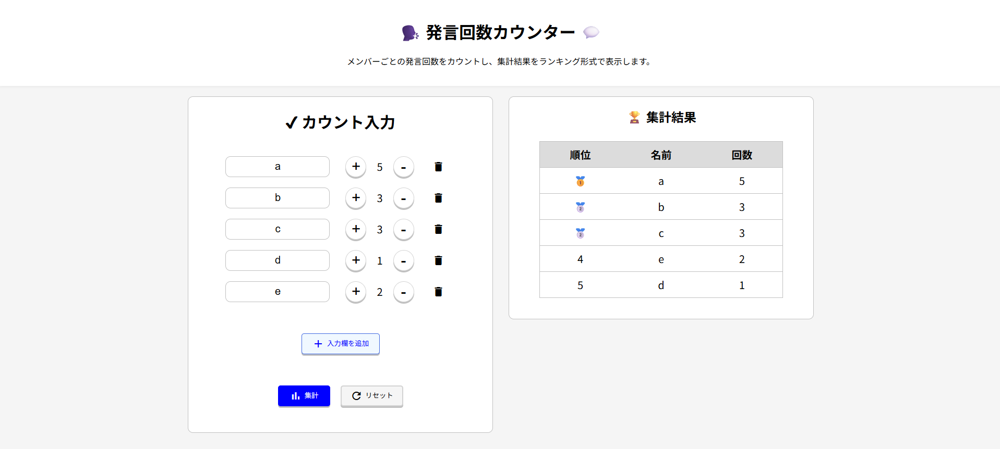

# 🗣️ Speaker Counter

ミーティングやグループワークで、メンバーごとの発言回数を簡単に記録・集計できるWebアプリケーションです。

発言回数を+-ボタンを用いてカウントし、集計ボタンを押すだけでランキング形式で結果を表示します。議論への参加状況を可視化し、発言の偏りを把握することを目的として制作しました。

手動でのリアルタイムカウント機能に加え、Discordの特定のテキストチャンネルからトーク履歴を自動抽出し、発言回数を自動集計するバックエンド連携機能を搭載しました。

---

## 主な機能

* メンバーの入力欄を自由に追加・削除
* ボタン操作による発言回数のカウント
* 発言回数順のランキング表示
* 同率順位に対応したランキング
* 🥇🥈🥉による上位3位の表示
* 入力内容をまとめてリセット
* PC・スマートフォン両対応のレスポンシブデザイン
* Discord自動集計機能:Discordの指定したテキストチャンネルから直近最大100件のメッセージ履歴を取得し、ユーザーごとの発言回数を自動で集計します。
** チャンネルIDを指定してメッセージ履歴を取得
** Bot自身の発言やシステムメッセージは集計対象から除外
**ユーザーごとの発言回数を集計し、降順に並べ替え
** 集計結果をフロントエンドに反映
※現在の実装では、ユーザーの表示名を基準に集計しています。そのため、同じ表示名のユーザーが複数いる場合は、発言回数が合算される可能性があります。

---

## 画面イメージ



---

## デモ

GitHub Pages

https://harukahida.github.io/SpeakerCounter/

*(※セキュリティおよびAPI通信の仕様上、Discord自動集計機能は以下の「ローカルでの起動方法」に沿ってサーバーを起動した環境で動作します)*

---

## 使用技術

* HTML5
* CSS3

  * Flexbox
  * Media Query
* JavaScript (Vanilla JS)
* Google Material Icons
* Node.js (v18+) ➔ バックエンド（APIサーバー）の構築
* Express ➔ APIエンドポイントの作成
* discord.js ➔ Discord APIとの通信、メッセージ履歴の取得
* dotenv / cors ➔ トークン（秘密の鍵）の安全な管理、CORS対策

---

## 💡 工夫したポイント

### レスポンシブデザイン

PCでは入力画面と集計結果を左右2カラムで表示し、スマートフォンでは縦1カラムへ自動で切り替わるレイアウトを採用しました。画面サイズに応じて見やすく操作しやすいUIを実現しています。

### 操作ミスを防ぐUI

カウントが0のときはマイナスボタンを自動的に無効化し、負の値になることを防止しています。また、新しい入力欄を追加すると自動でカーソルが移動するため、キーボードだけでスムーズに入力できます。

### 同率順位への対応

集計結果は発言回数の降順でソートし、同じ回数の場合は同じ順位を表示するよう実装しました。順位のずれが発生しないランキングアルゴリズムを作成しています。

### Discord連携におけるデータ処理

Discord Botをバックエンドに組み込み、指定されたテキストチャンネルのメッセージ履歴を取得できる構成にしました。
取得したメッセージからBotの発言を除外し、ユーザーごとの発言回数を集計したうえで、フロントエンドで扱いやすいJSON形式に変換して返却します。
また、Botのトークンは環境変数（.env）で管理し、ソースコードに直接記述しないようにしています。

---

## 🔥 苦労した点

入力欄を追加・削除できる仕様のため、削除後に新しい入力欄を追加するとIDが重複し、ボタン操作や集計結果が正しく動作しない問題が発生しました。

そこで、

* 削除しても番号が重複しないグローバルカウンターを導入
* 集計時にはIDではなく画面上のDOM要素を直接取得する方式へ変更

という設計に変更しました。
これにより、入力欄を何度追加・削除しても安定して動作するようになりました。

---

## ローカルでの起動方法（セットアップ）

### 1. クローンとライブラリのインストール
```bash
git clone [https://github.com/HarukaHida/SpeakerCounter.git](https://github.com/HarukaHida/SpeakerCounter.git)
cd SpeakerCounter
npm install
```

### 2. 環境変数の設定
ルートディレクトリに .env ファイルを新規作成し、ご自身のDiscord Botトークンを設定してください。

```env
DISCORD_TOKEN=あなたのDiscord_Botトークン
PORT=3000
```
(※Botには「MESSAGE CONTENT INTENT」の権限を付与し、対象のサーバーに招待しておいてください)

### 3. バックエンドサーバーの起動
```bash
node server.js
```
サーバー起動後、index.html をブラウザで開くことで、手動入力およびDiscord同期機能がすべて利用可能になります。

---

## 注意事項：Discord自動集計機能の利用について
Discord自動集計機能を利用するには、Discord Botがログインしたバックエンドサーバーを起動する必要があります。

GitHub Pagesで公開しているフロントエンドのみでは、Discord自動集計機能は利用できません。

また、Botが対象サーバーに参加しており、対象チャンネルのメッセージを閲覧できる権限を持っている必要があります。
---

## ディレクトリ構成

```text
SpeakerCounter/
├── index.html            # フロントエンド画面
├── style.css             # デザインCSS
├── count.js              # フロントエンド処理（DOM操作・API通信）
├── server.js             # Node.js/Expressによるバックエンド
├── package.json          # 依存ライブラリ一覧
├── package-lock.json     # ライブラリのバージョン詳細記録
├── .gitignore            # 秘密の鍵(.env)などをGit管理から除外
├── README.md             # 本ドキュメント
├── LICENSE               # MITライセンス
└── SpeakerCounter_image.png
```

---

## 今後追加したい機能

* **集計対象メッセージ数の拡張：** 現在は直近最大100件を取得する仕様のため、ページング処理を導入して、より多くのメッセージを集計できるようにする。
* **ユーザー識別方法の改善：** 現在は表示名を基準に集計しているため、DiscordユーザーIDを利用することで、同じ表示名のユーザーが合算されないようにする。
* **集計期間の指定：** メッセージの取得期間を指定できるようにし、特定の会議やグループワーク単位で発言回数を集計できるようにする。
* **APIのセキュリティ強化：** アクセス元の制限や認証機能を導入し、安全に利用できる構成にする。
---

## ライセンス

MIT License
